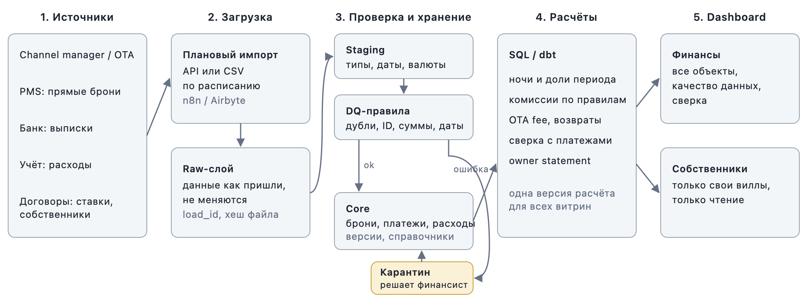

# Портфель вилл: дашборд, расчёты, качество данных

Тестовое задание на позицию Senior Business Systems Engineer (Finance & Automation). Прототип на 2–3 часа: рабочий расчёт, разбор ошибок в данных и схема будущей системы. Production-систему я не делал.

Есть два варианта, каждый можно смотреть отдельно:

- Google-таблица (основной вариант): [ссылка](https://docs.google.com/spreadsheets/d/10bRlTWU2wo7KbRkbOANFSbQaTnDPV2zAP-T884Ua-xg/edit?usp=sharing), та же таблица файлом `villa_finance.xlsx`.
- HTML-дашборд `dashboard.html`. Открывается двойным кликом, без установки и интернета. Онлайн-версия: https://test.nkokov.online (закрыта паролем, пароль передам отдельно).

Исходные CSV лежат в `data/` без изменений.

## Где что смотреть

| Что просили | Таблица | HTML |
|---|---|---|
| Прототип | Лист `Dashboard`: объект, период, переключатель «на проверке» | Вся страница |
| Финансовая логика | Лист `Методология`, расчёт по каждой строке на листах `calc_*` | Раздел «Финансовая логика» |
| Ошибки в данных | Лист `dq_log`, флаги проверок в колонках `chk:` | Раздел «Качество данных» |
| Архитектура | Лист `Методология` | Раздел «Архитектура» |

В таблице жёлтые ячейки на `Dashboard` можно менять, остальное считается формулами. Любую цифру можно проследить до строки исходного CSV. Формулы только `SUMIFS`, `COUNTIFS`, `INDEX/MATCH` и `IF`, работают в Excel и Google Sheets.

## Итог за сентябрь и октябрь 2026, все объекты

| Показатель | IDR |
|---|---:|
| Gross bookings | 1 342 815 036 |
| Возвраты | 86 163 513 |
| Net booking value | 1 256 651 523 |
| OTA fees | 183 008 072 |
| Management fee | 223 293 172 |
| Операционные расходы (из них pending 8 382 578) | 49 462 041 |
| Owner balance, оценка | 800 888 238 |
| Начислено к получению (net минус OTA) | 1 073 643 451 |
| Поступило за период | 485 396 549 |

Если убрать брони с пересечением дат, owner balance будет 258 648 677. От того, какие из них настоящие, итог меняется втрое.

Где платёж по брони есть, он совпадает с ожидаемым до рупии. Вся разница между начисленным и полученным по броням (562 480 847) приходится на 68 броней без единого платежа.

## Как считаю

Выручку признаю по ночам проживания. Так требует МСФО (IFRS) 15: проживание оказывается как услуга во времени, каждую ночь. Бронь с 25.09 по 03.10 (8 ночей) делится так: 6/8 в сентябрь, 2/8 в октябрь. Ночь считается от `check_in` включительно до `check_out` не включая.

В отчётах собственникам часто используют дату выезда, потому что это проще. Для сравнения, gross по месяцам:

| Метод | Сентябрь | Октябрь | Ноябрь |
|---|---:|---:|---:|
| По ночам (принят) | 757 178 005 | 585 637 031 | 0 |
| По дате выезда | 683 262 688 | 636 261 198 | 23 291 150 |

При методе по дате выезда в ноябрь уходят `R0003` и `R0052` (выезд 01.11). Сумма за все месяцы одинаковая, меняется только распределение. Метод выбран, но я всё равно прошу финдиректора его подтвердить.

```
доля в периоде      = ночей в периоде / всего ночей брони
net booking value   = gross_booking_value − refund_amount
OTA fee             = ota_fee × net / gross
management fee      = management_fee_rate × net
owner balance (оц.) = net − OTA fee − management fee − расходы
к получению         = net − OTA fee
поступило           = payments по payment_date
```

Начисляемые суммы умножаются на долю в периоде. Деньги считаю отдельно, по дате платежа, и с выручкой не складываю.

Ставку комиссии беру из `commission_rules` по объекту и дате заезда: 17%, для вилл Bukit 20%. База комиссии gross, потому что в правилах указано «OTA fees are separate». Возврат базу уменьшает.

Все 12 отмен в данных с полным возвратом. Net по ним 0, management fee 0. OTA fee по отменам считаю сторнированной: при полном возврате она тоже 0.

Расходы в начислениях учитываю все по `expense_date`, включая pending. В оттоке денег только paid.

Owner balance здесь оценка. Нет начального сальдо и выплат собственнику, налогов, правил удержаний при отменах, курса валют, договорённости о том, какие расходы несёт собственник, и даты среза данных.

Внутри считаю без округления, на экране показываю целые рупии. В рабочей базе суммы хранились бы в `NUMERIC`, а не во float.

## Ошибки в данных

Молча ничего не исправлял. Каждая запись получает одно из решений:

- исключено: в расчёт не попадает (14 записей);
- на проверке: в расчёте, но помечена, переключатель показывает итог без неё (86 броней);
- вопрос: решение за финансами.

Полный список с номерами строк CSV на листе `dq_log` и в HTML.

| Запись | Что не так | Решение |
|---|---|---|
| `R0015`, `P0075` | Полный дубль строки | Исключено, оставил первую |
| `R0034`, `P0017` | Объекта `V999` нет в `properties` | Исключено, на проверку |
| `E0017` | Объекта `V777` нет | Исключено, на проверку |
| `R0061` | USD при базовой валюте IDR, сумма 4 280 874 по масштабу похожа на рупии | Исключено: курса нет |
| `R0072` | Статус confirmed, refund 7 970 068 больше gross 7 070 068 ровно на 900 000, платежа нет. Похоже на отмену с опечаткой | Исключено, на проверку |
| `P0036`, `P0066`–`P0071` | Сумма 0 со статусом received | Исключено |
| `R0102` | `ota_fee` = −100 000 | На проверке |
| 86 броней | Пересечение дат на одной вилле | На проверке |

Что видно не сразу:

1. Пересечений много: 133 из 534 занятых вилло-ночей проданы дважды и больше. На V003 в ночь на 13.09 пять броней.
2. `R0149` и `R0150` похожи на две версии одной брони (V009, обе modified, почти одни даты). Платёж только по `R0150`.
3. `R0033` и `R0056`: V008, одинаковые даты, разные суммы. Платёж только по `R0056`.
4. У статуса modified нет ссылки на исходную бронь. Часть modified пересекается с confirmed на той же вилле, видимо старая версия осталась.
5. Платёж приходит уже за вычетом `ota_fee`. Если сравнивать его с gross, получится ложный недобор 12–17%.
6. У всех 31 прямой брони заполнена `ota_fee`.
7. Если сложить `ota_fee` без учёта отмен, OTA fees вырастут на 12 423 868.
8. Платежи есть только у броней с чётными номерами, 75 из 150.
9. Последний `updated_at` 15.10, а 19 платежей со статусом received датированы позже, до 05.11.

## Архитектура



Брони забираются из channel manager, деньги из банковских выписок, расходы из учётной системы. Ставки и собственники ведутся как справочник по договорам. Импорт идёт по расписанию (n8n или Airbyte) в raw-слой, где данные хранятся как пришли. Дальше staging приводит типы и названия, DQ-правила отправляют ошибки в карантин, проверенные записи попадают в core. Расчёты делаются на SQL или dbt поверх core, витрины для финансов и собственников строятся на этих расчётах.

Повторный импорт без дублей: файл с тем же хешем повторно не грузится, запись в core определяется ключом (`reservation_id`, `payment_id`, `expense_id`) и пишется через upsert. Если `updated_at` новее, появляется новая версия записи, идентичная строка пропускается.

Аудит: raw не меняется. У каждой строки core есть `load_id`, `valid_from` и `valid_to`, поэтому видно, как данные выглядели на любую дату. Исправления вносятся отдельными корректировками с автором и причиной, закрытый месяц блокируется.

Доступ: финансы видят всё и решают по карантину. Операционная команда видит брони и расходы без итогов собственников. Собственник видит только свои виллы (row-level security по `owner_id`). Ключи API хранятся в secret manager.

Сверку с деньгами в рабочей системе делал бы по банку, а не по таблице платежей: брони берутся из channel manager, деньги из банка, комиссия из отчёта о выплате OTA. Расхождения больше допуска уходят в очередь исключений.

## Ограничения и следующие шаги

Ограничения прототипа:

- одна валюта;
- ставка комиссии берётся на дату заезда, а не по каждой ночи;
- нет выплат собственникам, поэтому balance показывает результат периода;
- пересечения дат найдены, но не разрешены: без channel manager не понять, какая бронь живая;
- `dq_log` записан текстом, а сами проверки работают формулами;
- на десятках тысяч строк таблица станет медленной, это задача для базы данных.

Главный риск: если пересекающиеся брони в основном дубли, выручка завышена примерно втрое.

Что делать дальше:

1. Получить ответы на вопросы ниже и записать правила расчёта.
2. Настроить загрузку из channel manager и банка в базу по схеме выше.
3. Добавить выплаты собственникам и сальдо, собрать ежемесячный owner statement.

## Вопросы финансовому директору

1. Подтверждаете признание выручки по ночам? Или для отчётов собственникам нужна дата выезда?
2. Management fee считается от gross до возвратов или после?
3. Удерживает ли OTA комиссию при отмене с полным возвратом?
4. Что означает `ota_fee` у прямых броней?
5. Какие расходы относятся на собственника и учитывать ли pending?
6. Почему платежи есть только у броней с чётными номерами?
7. На какую дату сделана выгрузка и как понимать платежи после 15.10?
8. `V999` и `V777`: новые объекты, тесты или опечатки?
9. `R0061` в долларах или ошибка в поле валюты?
10. Как оформляется изменение брони: новая запись со ссылкой на старую или правка той же?
11. Какой системе верить, когда брони на одной вилле пересекаются?
12. Какие налоги и удержания учитывать в балансе собственника?

## Как проверял

Посчитал всё три раза независимо: формулами в таблице, на JavaScript в HTML и отдельно на Python. На пяти комбинациях фильтров цифры совпали до рупии. Итог по таблице объектов равен общему итогу. Google Sheets после импорта даёт те же значения.

Одну бронь пересчитал вручную. `R0028`: V020, ставка 20%, 25.09–03.10, gross 7 444 951, ota_fee 1 116 743. В сентябре 6 ночей из 8, gross сентября 5 583 713. Платёж 6 328 208 равен gross минус ota_fee.

Инструменты: Google Sheets, HTML и JavaScript без библиотек, Caddy для онлайн-версии (настройки в `deploy/`). AI-ассистент (Claude) помогал с профилингом данных и вёрсткой, правила и формулы я проверял сам.

Затраченное время: __ ч.
